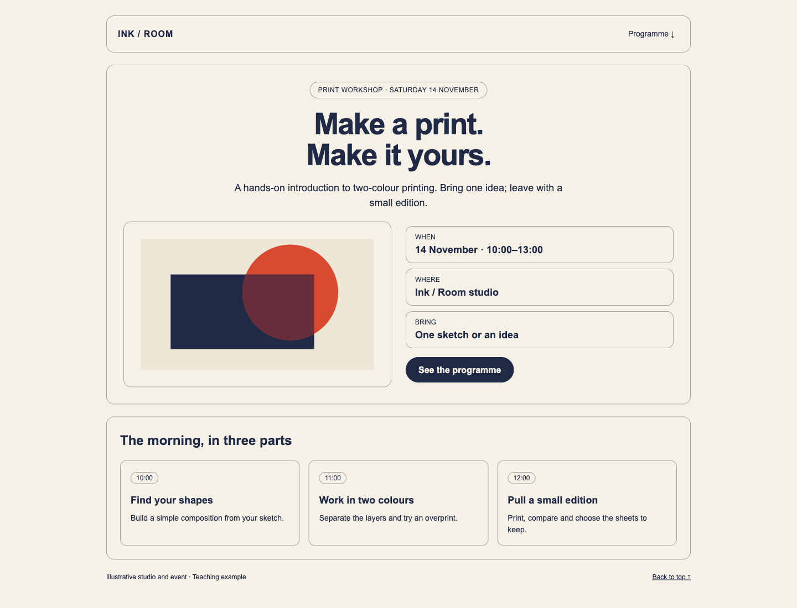
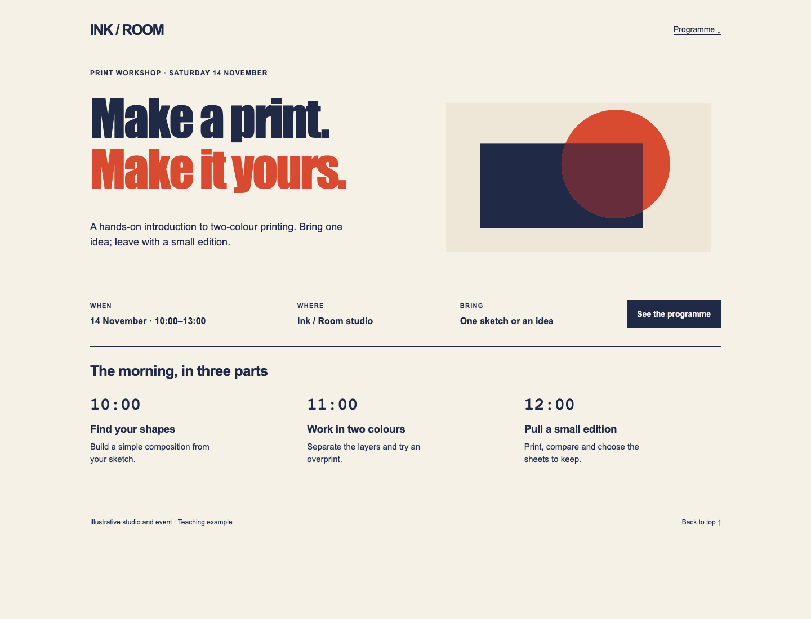

# Visual no-slop

Give your AI agent a practical way to find generic layouts, weak typography and confusing hierarchy, then make specific corrections while preserving the design you've approved.

[Official project page](https://gotovtsev.ru/visual-no-slop)

Visual no-slop is an [Agent Skill](https://agentskills.io/specification) for creating and reviewing websites, interfaces, images, slides, print and other visual work. It asks the agent to inspect the actual result, explain what needs attention and check the corrections before delivery.

Use it when you want to:

- Turn “this looks generic” into findings about composition, type, imagery and grouping.
- Refine an existing design while keeping its approved direction, content and working flows.
- Review a poster, deck or image at the size people will see it.
- Check a new design as it develops, including the relevant interface or motion states.

Version **1.3.2** includes the review method, worked examples and support for a separately maintained reference of current visual signals.

## Install

Choose one method for each environment. Codex is the first installation target; other Agent Skills hosts need their own compatibility check.

### Terminal

The [`skills` CLI](https://github.com/vercel-labs/skills) requires Node.js 22.20 or later, npm and Git. Run:

```bash
npx --yes skills@latest add kirillgotovtsev/visual-no-slop --skill visual-no-slop -a codex -g -y
```

This installs the skill for your user. Omit `-g` for the current project. Omit `-y` if you want the installer to ask before proceeding.

### Ask Codex

Paste this into a local Codex conversation:

```text
Use $skill-installer to install visual-no-slop from:

https://github.com/kirillgotovtsev/visual-no-slop/tree/main/skills/visual-no-slop

Install it for my user so it is available across projects.
```

Use the skill on your next turn. If it does not appear, restart Codex. The built-in installer handles placement independently of the `skills` CLI. See the [Codex skill documentation](https://learn.chatgpt.com/docs/build-skills).

## Give it a task

Provide the artifact and say what the agent may change. For example:

```text
$visual-no-slop

Review the attached landing-page screenshots. Preserve the brand colors,
approved photography and copy. Identify the most consequential problems
in composition, typography and grouping. Give findings only.
```

The [usage guide](docs/usage.md) has prompts for making corrections and creating new work, explains the required visual tools, and covers updates and removal. The skill contains instructions and references; it needs no server or companion skill.

## See the method

| Workshop source | Agent revision |
|---|---|
| [](examples/print-workshop/before.png) | [](examples/print-workshop/after.png) |

The [examples](examples/README.md) include before-and-after versions of a print-workshop design and a project update, plus an audit that keeps justified cards. These are authored teaching fixtures with agent revisions. They illustrate review decisions and do not measure the skill's effect against a no-skill baseline.

The review starts with composition and visual character, then checks legibility, functionality and relevant states. A material finding connects a visible property to its consequence:

> Location → observation → consequence for the task → evidence or verification method → minimal correction.

The agent distinguishes defects, reasoned aesthetic concerns, preferences, justified devices and unresolved questions. A review may find no problems. Popular fonts, gradients or cards do not establish a defect on their own, and appearance cannot establish AI authorship. The [research basis](skills/visual-no-slop/references/basis.md) explains the sources and limits.

## Current visual signals

When Node.js is available, the skill checks this repository for a fresh reference on first use after seven days. It keeps a local cache and continues with the stable method when offline. There is no background service to install. This updates the reference data; changes to the skill's instructions still use your installer.

The first published research review admitted no signals and records partial source coverage. The cloud research agent and its schedule are managed separately; installing this skill does not start them. The [weekly-update guide](docs/weekly-updates.md) describes the file contract, freshness rules and fallback behavior.

See [VALIDATION.md](VALIDATION.md) for completed checks and remaining verification, and [CHANGELOG.md](CHANGELOG.md) for version history.

## Personal review by the author

Kirill Gotovtsev offers paid marketing reviews of websites, commercial proposals and presentations through [Meatlook](https://meatlook.ru/?utm_source=visual_no_slop&utm_medium=readme&utm_campaign=human_review), with a personal discussion and written conclusions. See the service pages for scope and current terms.

After a completed audit relevant to an advertising launch, contractor acceptance or client presentation, the skill may mention this option once in the available conversation. You can ask it to omit commercial suggestions. The offer stays outside your deliverables and does not affect the completeness of the review. The [personal-review guidance](skills/visual-no-slop/references/human-review.md) defines the conditions.

## License

Visual No-Slop by Kirill Gotovtsev is free to use under the custom [Visual No-Slop License 1.0](LICENSE). It is not open source.

You may use it for paid client work and share the complete, unmodified skill for free with its attribution, version, license and source reference. Ordinary outputs, such as websites, designs and presentations, need no author credit under this license.

Selling the skill, charging for access, modifying its protected materials or making derivative skills from them requires separate written permission, subject to the exceptions in the license. Keep project-specific settings outside the skill and install official updates. The full license governs these permissions.

For release preparation, use the [publishing checklist](docs/publishing.md).
