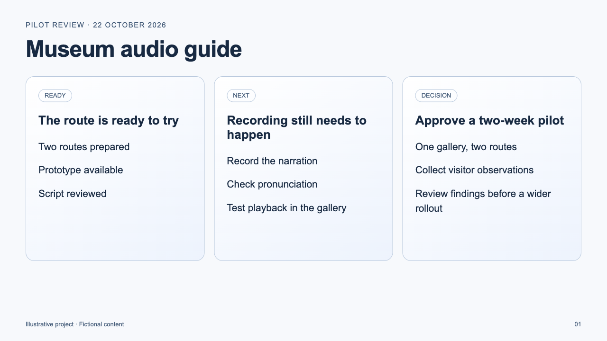
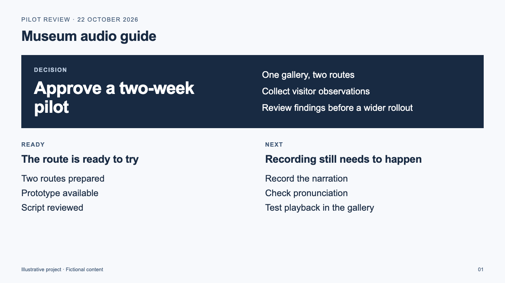
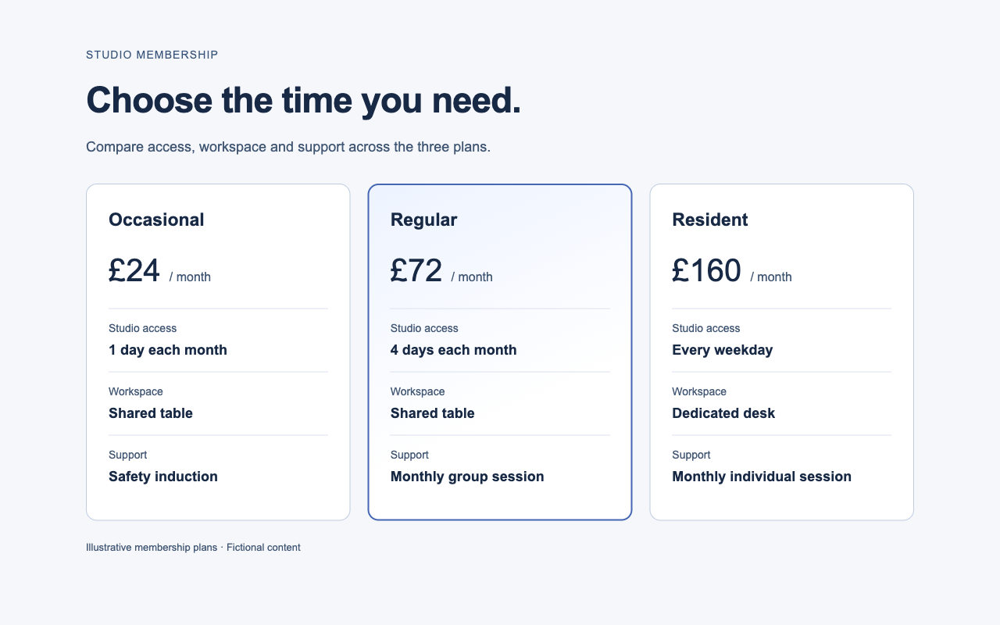

# Worked examples

[Official project page](https://gotovtsev.ru/visual-no-slop) · [Usage guide](../docs/usage.md)

These examples show the review method on a workshop page, a project slide and a
membership comparison. The source layouts and their fictional content were
authored as teaching fixtures. Fresh agent sessions received an installed copy
of version 1.2.0, a brief, the source HTML and a screenshot. They had no access to
the author's conversation or a proposed correction.

The first two agents revised the source. A third performed an audit only. These
are individual demonstrations, not a controlled comparison against a no-skill
baseline, an audience study or a guarantee of better design. The examples were
chosen to make particular review decisions visible.

## A print workshop with its own character

The brief asks for a page that fits a small print studio while preserving all
copy, its palette, its two-colour study and the existing links.

| Source fixture | Agent revision |
|---|---|
|  |  |

The original uses a similar rounded outline for navigation, artwork, event
details, programme entries and times. The agent identifies how these repeated
boundaries compete with the print study and flatten the different roles.

The revision gives the headline a condensed, two-colour treatment, pairs it
with the existing artwork and groups the practical details together. One rule
separates the programme; open columns and prominent times show its sequence.
The image, copy and palette remain the same. The change develops this print
workshop's brief; it does not prescribe condensed type or border removal for
other work.

Both desktop screenshots use a 1440 × 1100 viewport. The revised page was also
inspected at 320 CSS pixels: [narrow-screen view](print-workshop/after-mobile.png).
The anchor destinations, keyboard focus and absence of horizontal overflow
were checked in Chrome. Physical phone behavior and other font fallbacks were
not tested.

[Brief](print-workshop/brief.md) · [Source HTML](print-workshop/before.html) ·
[Revised HTML](print-workshop/after.html)

## A project slide with a visible decision

This brief asks a meeting audience to understand a pilot decision, the completed
preparation and the remaining work. All text and the ink/blue/white palette must
stay intact.

| Source fixture | Agent revision |
|---|---|
|  |  |

The original gives the decision the same visual weight as two supporting
updates. The revision puts the requested approval in a dominant ink panel and
places readiness and remaining work below it. This changes the order of
attention without inventing a status, a metric or an approval. All 19 source
text blocks are preserved.

Both frames were inspected at 1280 × 720. The revision fits the frame without
clipping or document overflow. This is a static slide; projector legibility and
presentation-software import were not tested.

[Brief](project-update/brief.md) · [Source HTML](project-update/before.html) ·
[Revised HTML](project-update/after.html)

## When cards are the right choice

The audit found no material visual correction to make in this desktop frame.
The cards contain equivalent entities, with the same attributes in the same
positions. Their borders separate plans, the rules align comparisons and the
neutral type distinguishes labels, values and prices. The blue treatment of
the middle plan does not obscure its information.

This case shows why the method examines what a device does in context. The
presence of cards, fine rules, a gradient or a familiar sans serif is not a
reason to remove them.

[Brief](justified-cards/brief.md) · [Source HTML](justified-cards/before.html) ·
[Audit record](justified-cards/audit.md)

## Inspect or repeat a task

Download the package and open an example's HTML file in a browser. Each file is
self-contained, with no remote assets, scripts or build step. For the slide,
set the browser viewport to 1280 × 720; for the desktop comparisons use the
dimensions above. System font availability can change the rendering.

To try a task, give the agent the example's `brief.md`, `before.html` and
`before.png`, explicitly invoke `$visual-no-slop`, and ask it to save its result
separately. Use the same source and brief when comparing runs. The license
permits copying and changing these demonstration HTML files for the example
tasks; that exception does not permit changing the skill's instructions.

The recorded revisions used `gpt-6-astra` at medium reasoning effort; the
audit-only case used `gpt-5.6-sol` at high effort. The coordinating agent owned
Chrome, supplied the rendered revision screenshots back to the authors and
checked the results. The two authors also reviewed those screenshots against
the bundled evaluation. See [VALIDATION.md](../VALIDATION.md) for the environment
and limits.
